

### Miguel Carino

*Linux salaryman, advocate for system-agnostic FOSS solutions, having an affair with proprietary firmware on the side.*

System administration · Monitoring and infrastructure · Scripting · DevOps · Web development · OSINT

**[carino.systems](https://carino.systems/)** — free tools that run in your browser. 
Nothing to install, no account, and your files never leave your computer.

 

<table align="center">
<tr><th colspan="3" align="left">IT and networks</th></tr>
<tr>
<td width="33%" align="center" valign="top"><a href="https://hardware.carino.systems/">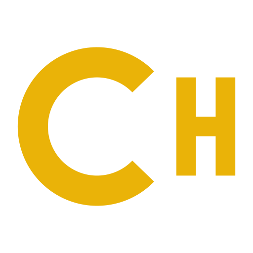</a> <a href="https://hardware.carino.systems/"><b>Hardware</b></a> MAC vendor lookup, Dell service tags, warranty and driver links</td>
<td width="33%" align="center" valign="top"><a href="https://ping.carino.systems/">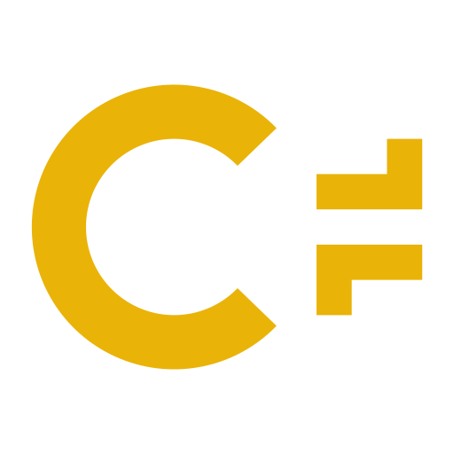</a> <a href="https://ping.carino.systems/"><b>Ping</b></a> · <a href="https://test.carino.systems/"><b>Test</b></a> Latency, jitter, packet loss and network diagnostics</td>
<td width="33%" align="center" valign="top"><a href="https://netplan.carino.systems/">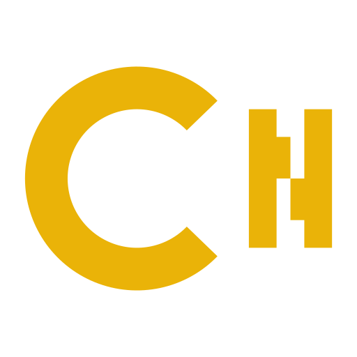</a> <a href="https://netplan.carino.systems/"><b>Netplan</b></a> Linux network configs without YAML mistakes</td>
</tr>
<tr>
<td align="center" valign="top"> <a href="https://topo.carino.systems/"><b>Topo</b></a> Network diagrams, shared as a private link</td>
<td align="center" valign="top"><a href="https://setup.carino.systems/">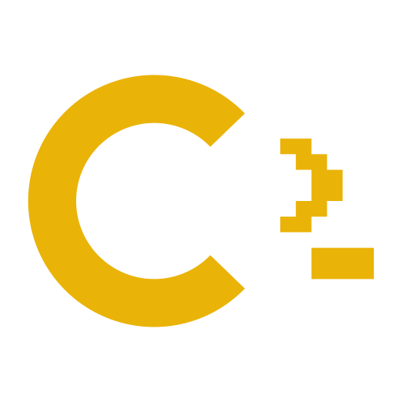</a> <a href="https://setup.carino.systems/"><b>Setup</b></a> One command that sets up Linux, Windows or macOS</td>
<td align="center" valign="top"><a href="https://software.carino.systems/">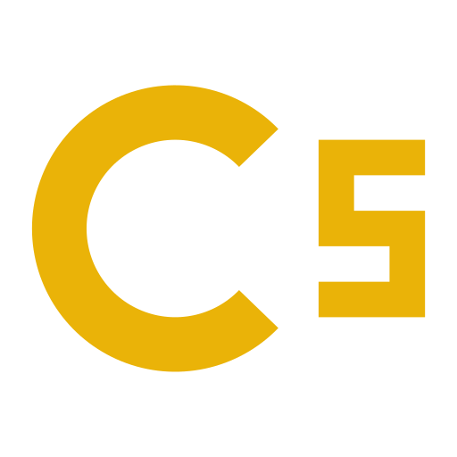</a> <a href="https://software.carino.systems/"><b>Software</b></a> Download links and install commands</td>
</tr>
<tr><th colspan="3" align="left">Files and privacy</th></tr>
<tr>
<td align="center" valign="top"><a href="https://metadata.carino.systems/">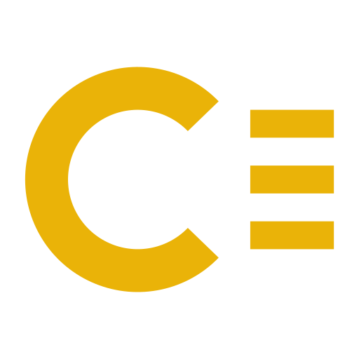</a> <a href="https://metadata.carino.systems/"><b>Metadata</b></a> See and edit file metadata, strip GPS from photos</td>
<td align="center" valign="top"> <a href="https://media.carino.systems/"><b>Media</b></a> PDF to image, OCR, image and audio conversion</td>
<td align="center" valign="top"> <a href="https://password.carino.systems/"><b>Password</b></a> Strong passwords, shared safely</td>
</tr>
<tr>
<td align="center" valign="top"><a href="https://hash.carino.systems/">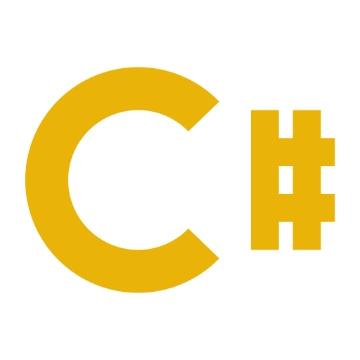</a> <a href="https://hash.carino.systems/"><b>Hash</b></a> Watch SHA-256 work, step by step</td>
<td align="center" valign="top"><a href="https://fiscal.carino.systems/">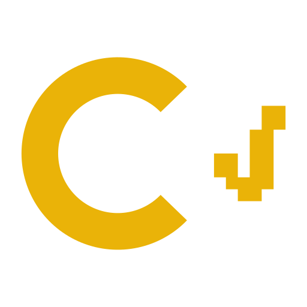</a> <a href="https://fiscal.carino.systems/"><b>Fiscal</b></a> Your tax IDs, checked on your device</td>
<td align="center" valign="top"><a href="https://offline.carino.systems/">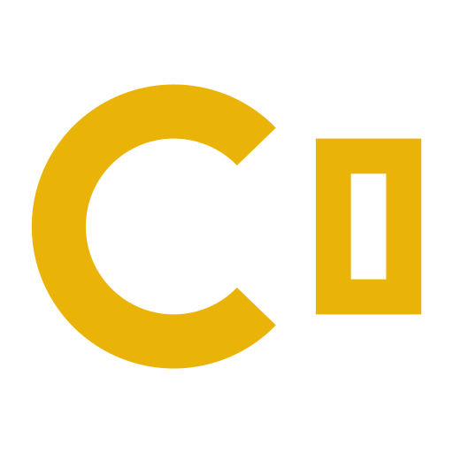</a> <a href="https://offline.carino.systems/"><b>Offline</b></a> Plan an intranet that works without internet</td>
</tr>
<tr><th colspan="3" align="left">Everyday</th></tr>
<tr>
<td align="center" valign="top"><a href="https://vitae.carino.systems/">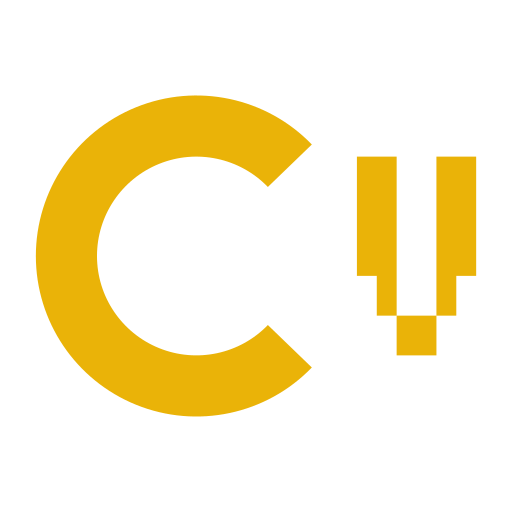</a> <a href="https://vitae.carino.systems/"><b>Vitae</b></a> Résumé builder with PDF export</td>
<td align="center" valign="top"> <a href="https://kanban.carino.systems/"><b>Kanban</b></a> A task board that lives in its link</td>
<td align="center" valign="top"><a href="https://quote.carino.systems/">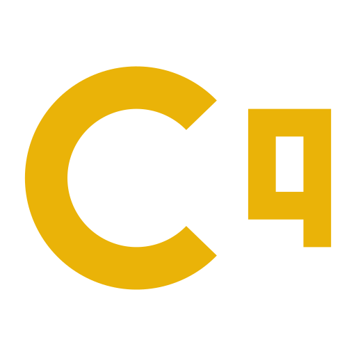</a> <a href="https://quote.carino.systems/"><b>Quote</b></a> Price quotes exported to PDF</td>
</tr>
<tr>
<td align="center" valign="top"><a href="https://subs.carino.systems/">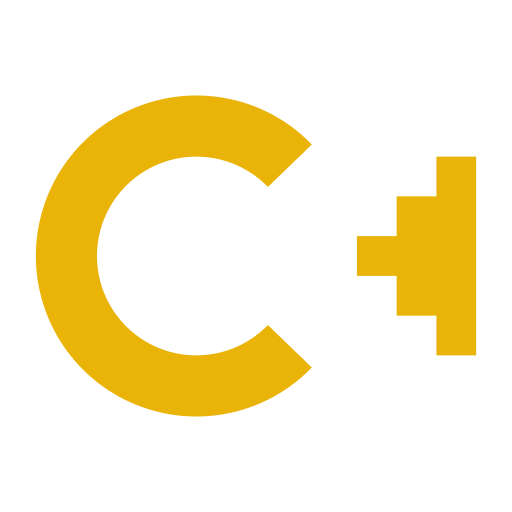</a> <a href="https://subs.carino.systems/"><b>Subs</b></a> Fix out-of-sync subtitles and lyrics</td>
<td align="center" valign="top"><a href="https://time.carino.systems/">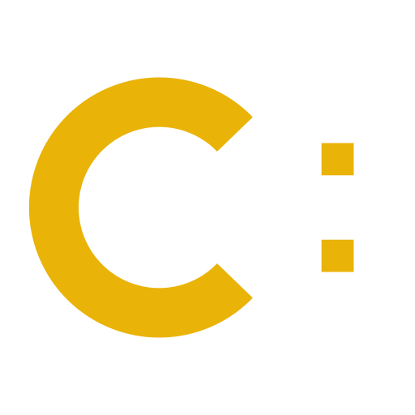</a> <a href="https://time.carino.systems/"><b>Time</b></a> World clock, UTC and Unix epoch</td>
<td align="center" valign="top"><a href="https://learn.carino.systems/">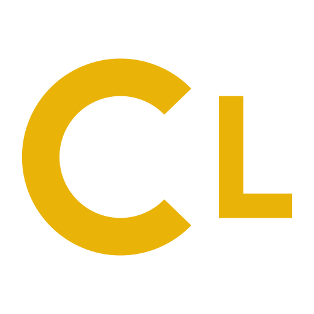</a> <a href="https://learn.carino.systems/"><b>Learn</b></a> Lessons with labs: assembly, Bash, Git, networking</td>
</tr>
<tr><th colspan="3" align="left">For fun</th></tr>
<tr>
<td align="center" valign="top"><a href="https://cybercity.carino.systems/">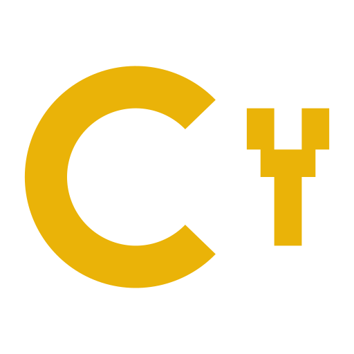</a> <a href="https://cybercity.carino.systems/"><b>CyberCity</b></a> Walkable worlds drawn in text characters</td>
<td align="center" valign="top"><a href="https://asobi.carino.systems/">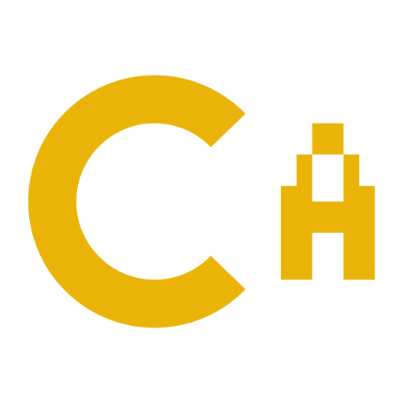</a> <a href="https://asobi.carino.systems/"><b>Asobi</b></a> Shogi and Hanafuda in the browser</td>
<td align="center" valign="top"> <a href="https://butter.carino.systems/"><b>ButterEye</b></a> Smooth-motion video for mpv</td>
</tr>
</table>

Every tool is open source — the code is in the repositories below.

<!--
This repository is a GitHub profile README, not a software project. It carries
no LICENSE file because there is nothing here to license: the content is a short
personal description and the marks are the projects' own logos.

Software projects live in the other repositories, each of which states its own
licence. See https://carino.systems
-->
